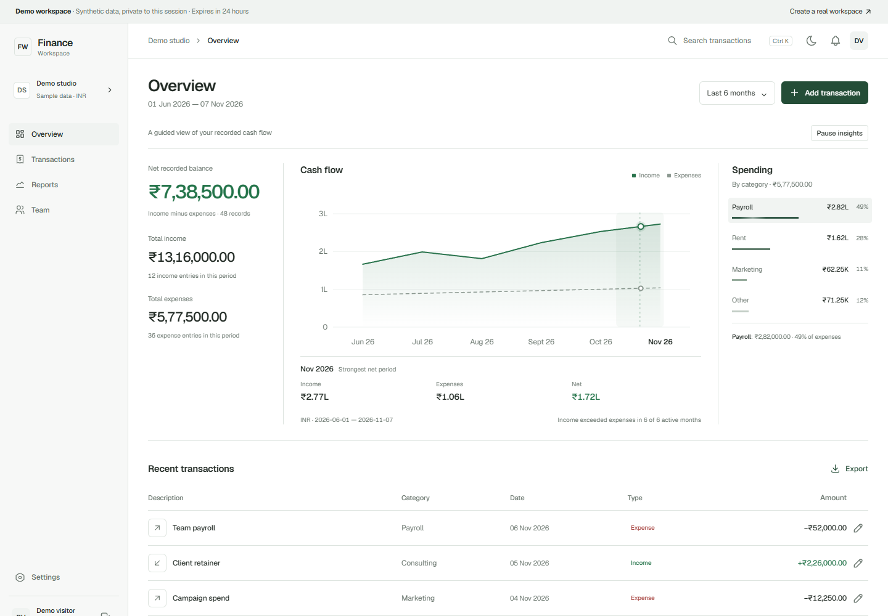

# Finance Workspace

A focused income-and-expense workspace for small teams, with a private interactive demo and server-enforced role permissions. Built with **Express 5, TypeScript, Prisma, SQLite, and vanilla JavaScript**.



## What it does

- **Private workspaces:** account creation, sign-in/out, single-use team invitations, and switching between workspaces you belong to.
- **Isolated demo:** each visitor gets 48 synthetic transactions in their own editable workspace. Demo workspaces expire after 24 hours.
- **Accurate money:** amounts are stored as integer paise. Exact values are serialized as strings and formatted with `BigInt`; charts use numerical projections.
- **Transaction management:** create, edit, soft-delete, restore, search, sort, date/type filters, pagination, and CSV export. Version checks prevent stale edits from overwriting newer changes.
- **Reports:** income, expenses, net movement, categories, and zero-filled daily/monthly series. Continuous chart focus explains each period without changing the underlying records.
- **Team access:** Admin, Analyst, and Viewer roles. Permission changes apply to existing sessions, and concurrent changes cannot remove the last active administrator.
- **Responsive UI:** light/dark themes, keyboard navigation, reduced-motion support, and explicit loading, empty, and error states.

### Permissions

| Capability | Admin | Analyst | Viewer |
| --- | :---: | :---: | :---: |
| Summaries, reports, report CSV | ✓ | ✓ | ✓ |
| Individual records, transaction CSV, activity | ✓ | ✓ | — |
| Create/edit/delete/restore records | ✓ | — | — |
| Members, invitations, workspace settings | ✓ | — | — |
| Own profile and password | ✓ | ✓ | ✓ |

## Run locally

Use **Node.js 24 LTS** and npm.

```sh
git clone https://github.com/Ronack-Kumar/finance-workspace.git
cd finance-workspace
npm ci
cp .env.example .env
npm run db:setup
npm run build
npm start
```

PowerShell: use `Copy-Item .env.example .env` instead of `cp`.

Open **http://localhost:3000**. Choose **Explore the live demo** or create a real workspace. No default passwords or pre-created administrator accounts are shipped. The first account in a new workspace becomes its administrator.

For development, run `npm run dev`. If changing the port, change both `PORT` and `APP_ORIGIN` in `.env`. Use the exact configured origin in your browser; mutation requests from other origins are rejected.

### Invite a teammate

Open **Team → Invite member**, enter their email and role, and copy the generated link. Share it directly. The link is email-bound, single use, and valid for seven days. Existing account holders can sign in and join; new teammates can create an account through the link. Email delivery is not configured or simulated.

## Verify

```sh
npm run check
npx playwright install chromium
npm run test:e2e
```

The API suite uses a temporary SQLite database and real HTTP requests. Browser tests use a separate temporary database and production build on port 4318. Neither suite modifies the development database.

Coverage includes cross-workspace requests, decimal arithmetic, role enforcement, session revocation, invitation replay, concurrent last-admin changes, record conflicts, CRUD persistence, browser exports, mobile navigation, and reduced motion. GitHub Actions runs these checks and builds the deployment image.

## Deployment

A non-root Docker image, persistent volume configuration, startup migrations, health endpoint, and graceful shutdown are included. Production requires an HTTPS `APP_ORIGIN` and a correctly configured reverse proxy.

See **[deployment and backup instructions](docs/DEPLOYMENT.md)**. Public hosting is a separate setup step; the repository does not imply a live hosted service.

## Project map

```text
src/                 Express routes, authentication, validation, demo lifecycle
prisma/              Schema and versioned SQLite migration
public/              Connected frontend, charts, local fonts and icons
tests/               HTTP integration and Playwright browser tests
scripts/             Isolated test runners and container entrypoint
design-previews/     Original interactive design explorations
docs/                API, architecture and deployment notes
```

- [API contract](docs/API.md)
- [Architecture and boundaries](docs/ARCHITECTURE.md)
- [Design system](DESIGN.md)
- [Product scope](PRODUCT.md)

**Built by [Ronack Kumar](https://github.com/Ronack-Kumar).** Code is ISC licensed; bundled font and icon licenses are retained beside their assets.
